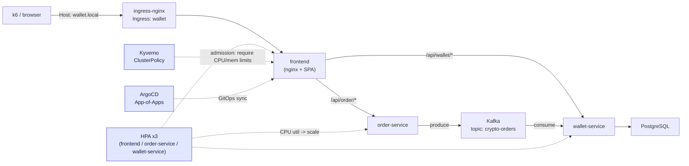
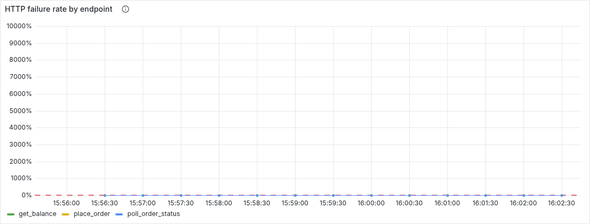
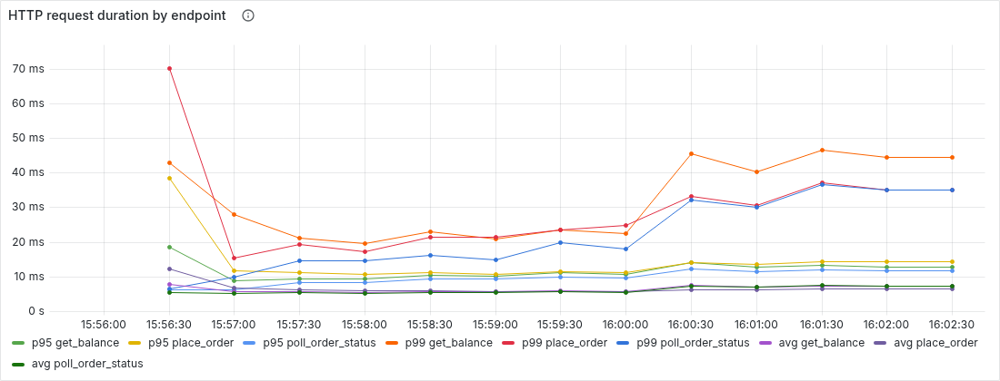
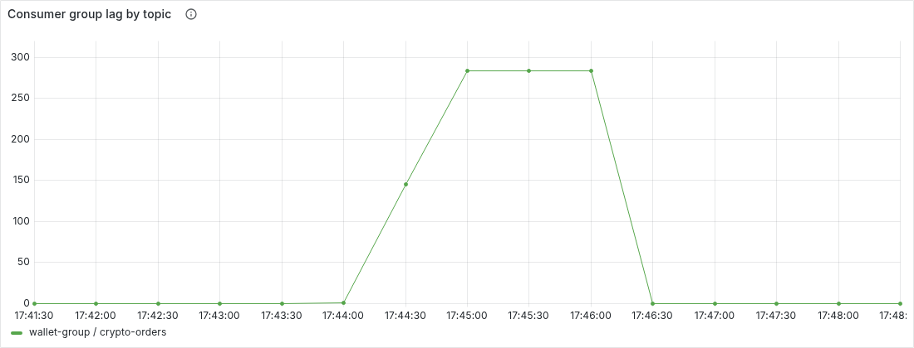
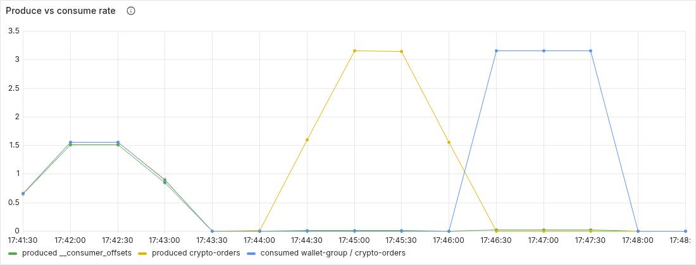
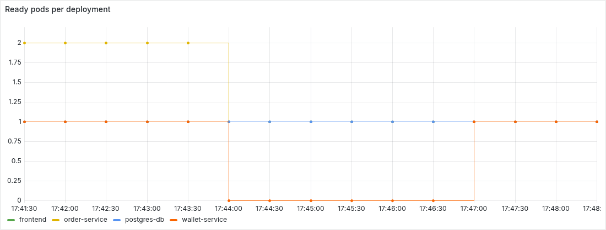

# Crypto Wallet Service: a GitOps Internal Developer Platform

[](https://github.com/SaharBe/crypto-wallet-service/actions/workflows/pr-checks.yml)
[](https://github.com/SaharBe/crypto-wallet-service/actions/workflows/ci.yml)

This is a platform-engineering portfolio project. It is a small event-driven
crypto wallet (Node.js microservices, Kafka, PostgreSQL) running on an
**internal developer platform**. The platform is built the way a real
platform team would build one:

- **Git is the only way to change the cluster.** ArgoCD reconciles every
  component from this repository (App-of-Apps plus an ApplicationSet), with
  `selfHeal` and `prune` turned on.
- **Secrets never touch git.** HashiCorp Vault holds them, and External
  Secrets Operator syncs them into the cluster. Vault itself is configured
  by Terraform.
- **Policy-as-code at admission.** Kyverno rejects any workload Pod that
  lacks CPU and memory limits.
- **Zero-trust east-west traffic.** The app namespace is default-deny for
  ingress. NetworkPolicies open only the real request path, and the EKS
  VPC CNI enforces them.
- **Observable and load-tested.** Prometheus and Grafana come with
  dashboards stored as code. k6 load tests push their metrics into
  Prometheus, and every PR runs a k6 performance gate on an ephemeral Kind
  cluster.
- **Fully automated delivery.** A merge to `main` builds images, pushes
  them to ECR, and pins the new immutable tag in the manifests through an
  auto-merged PR. ArgoCD then rolls the change out. Nobody runs
  `kubectl apply` by hand.

The wallet app is deliberately simple. The point of the project is
everything around it.

> **Deeper reading:** [architecture.md](architecture.md) (component
> breakdown, sync waves, secret flow, CI/CD pipeline) ·
> [CONTRIBUTING.md](CONTRIBUTING.md) (branching, PRs, live-cluster
> validation) · [tests/performance/README.md](tests/performance/README.md)
> (k6 suite)

## Table of Contents

- [Architecture at a Glance](#architecture-at-a-glance)
- [Tech Stack](#tech-stack)
- [Repository Layout](#repository-layout)
- [Prerequisites](#prerequisites)
- [Quickstart A: Local Development (Docker Compose)](#quickstart-a-local-development-docker-compose)
- [Quickstart B: Cloud Deployment (Terraform + EKS + ArgoCD)](#quickstart-b-cloud-deployment-terraform--eks--argocd)
- [Local vs. Production Traffic Routing](#local-vs-production-traffic-routing)
- [Operations & Makefile Commands](#operations--makefile-commands)
- [CI/CD](#cicd)
- [Autoscaling & Resilience Strategy](#autoscaling--resilience-strategy)
- [Resilience Experiments](#resilience-experiments)
- [Security Model](#security-model)
- [Known Limitations & Hardening Roadmap](#known-limitations--hardening-roadmap)
- [Development & Contributing Workflow](#development--contributing-workflow)

## Architecture at a Glance

**Services** live in `services/`. Each one is a Deployment plus a Service in
`k8s/components/`, namespace `crypto-wallet-app`:

- **frontend** (nginx): serves a static SPA and proxies `/api/wallet/*` and
  `/api/order/*` to the backend Services on the same origin, so no CORS is
  needed.
- **order-service** (Express + KafkaJS): accepts `POST /orders`, publishes
  the order to the `crypto-orders` Kafka topic, and returns
  `202 Accepted` right away. Orders are processed asynchronously.
- **wallet-service** (Express + KafkaJS + `pg`): consumes `crypto-orders`,
  applies the balance change in PostgreSQL, and serves
  `GET /balance/:userId`.
- **postgres-db**: the wallet ledger, stored on a `gp3` EBS volume.
- **Kafka** (Bitnami chart, KRaft mode): decouples order intake from
  wallet-balance updates.



**Control plane:** a single `root-application` (App-of-Apps,
`k8s/root-app.yaml`) points ArgoCD at `k8s/apps/`. That directory fans out
into one `Application` or `ApplicationSet` per concern: ingress-nginx,
Kyverno and its policies, Vault, External Secrets, Kafka, metrics-server,
the monitoring stack, and the wallet app itself. Sync waves order the
bootstrap so that CRDs and secret stores exist before anything consumes
them. [architecture.md](architecture.md) covers the full breakdown.

## Tech Stack

| Area | Technology | Role in the platform |
|---|---|---|
| Cloud & IaC | **AWS EKS 1.31**, VPC, ECR, EBS CSI · **Terraform** | 3× `t3.medium` managed node group in private subnets. Remote state in S3 with a DynamoDB lock table (`terraform/state-backend`) |
| Orchestration | **Kubernetes**, **Kustomize** | Base manifests in `k8s/components`, plus a CI overlay for Kind |
| GitOps | **ArgoCD** (App-of-Apps + ApplicationSet) | Continuous reconciliation from `main` with `selfHeal` + `prune` |
| Secrets | **HashiCorp Vault** + **External Secrets Operator** | Vault KV v2 with Kubernetes auth and one scoped role per consumer, configured by Terraform (`terraform/vault-config`) |
| Policy | **Kyverno** | `require-resource-limits` ClusterPolicy in **Enforce** mode |
| Network isolation | **NetworkPolicy** + **AWS VPC CNI** network policy agent | Default-deny ingress in `crypto-wallet-app`, one allow rule per hop of the request path |
| Ingress | **ingress-nginx** | Host-based L7 routing for `wallet`, `argocd`, `grafana` and `vault` `.local` |
| Autoscaling | **HPA** + **metrics-server** | CPU-based scaling for all three services |
| Messaging | **Apache Kafka** (Bitnami chart, KRaft) + **kafka-exporter** | Async order pipeline, with consumer-lag metrics |
| Database | **PostgreSQL** | Wallet ledger; credentials delivered from Vault |
| Services | **Node.js** (Express, KafkaJS, `pg`), **nginx** | `order-service`, `wallet-service`, `frontend` |
| Observability | **Prometheus** + **Grafana** (kube-prometheus-stack) | Dashboards stored as JSON in git. The remote-write receiver ingests k6 metrics |
| Performance | **k6** | Load, spike and Kafka-pipeline stress scripts, run locally or as an ephemeral in-cluster Pod |
| CI/CD | **GitHub Actions** | PR gate (lint, kustomize, kubeconform, helm template, k6 on Kind) and build → ECR → auto-pin pipeline |
| Local dev | **Docker Compose** | The full app stack with no cloud dependencies |

## Repository Layout

```
.
├── services/                 # order-service, wallet-service (Node.js), frontend (nginx)
├── k8s/
│   ├── root-app.yaml         # App-of-Apps entry point (applied once by bootstrap.sh)
│   ├── apps/                 # One ArgoCD Application per platform concern (+ ApplicationSet)
│   ├── components/           # Wallet app base manifests (Deployments, HPA, ExternalSecret, Postgres, NetworkPolicies)
│   ├── overlays/ci/          # Kind overlay used by the PR performance gate
│   └── bootstrap-secrets/    # Template for the one imperatively-seeded repo credential
├── terraform/
│   ├── state-backend/        # S3 + DynamoDB remote state (run first)
│   ├── infra/                # VPC, EKS, ECR, EBS CSI driver
│   ├── vault-config/         # Vault auth, policies, roles, KV secrets
│   └── modules/vault-config/ # Reusable "one consumer = one role + policy + secret" module
├── tests/performance/        # k6 scripts + in-cluster runner
├── local-dev/                # Compose init SQL + end-to-end smoke test
├── scripts/                  # setup-hosts, CI helpers
├── docker-compose.yml        # Local stack
├── bootstrap.sh              # End-to-end cloud bootstrap (`make up`)
└── Makefile                  # Single operations entry point (`make help`)
```

## Prerequisites

| Tool | Local path (A) | Cloud path (B) | Used for |
|---|:---:|:---:|---|
| [Docker](https://docs.docker.com/get-docker/) with Compose v2 | ✅ | ✅ | Running the local stack and building images (`make build`) |
| `make`, `bash`, `curl` | ✅ | ✅ | Every workflow runs through the root `Makefile` |
| [`kubectl`](https://kubernetes.io/docs/tasks/tools/) | | ✅ | Talking to the EKS cluster |
| [AWS CLI](https://aws.amazon.com/cli/) (configured) | | ✅ | EKS auth and ECR login |
| [`terraform`](https://developer.hashicorp.com/terraform/install) | | ✅ | Provisioning AWS infrastructure and configuring Vault |
| [`argocd` CLI](https://argo-cd.readthedocs.io/en/stable/cli_installation/) | | ✅ | Admin login and verification at bootstrap |
| `envsubst` (`gettext` package) | | ✅ | Templating `k8s/root-app.yaml` at bootstrap |
| [`k6`](https://k6.io/docs/get-started/installation/) | optional | optional | Load testing. Without it, `make test-load` falls back to the `grafana/k6` Docker image |
| [`helm`](https://helm.sh/docs/intro/install/) | | optional | Only for running the Helm-values PR check locally. ArgoCD renders the charts itself |

The cloud path provisions **billable AWS resources** (EKS control plane,
3 EC2 nodes, NAT gateway, EBS volumes). Run `make down` when you are done.

## Quickstart A: Local Development (Docker Compose)

This path runs the whole application on your machine: Postgres, ZooKeeper
and Kafka, `wallet-service`, `order-service` and `frontend`. It uses the
same ports, environment variables and Kafka topic as the EKS deployment.
It needs no AWS account, Vault or Kubernetes, only Docker with Compose v2.

```bash
make local-up      # first run creates .env with a random local DB password, then builds, starts and waits for healthchecks
make local-smoke   # end-to-end verification (see below)
open http://localhost:8088   # or xdg-open on Linux
make local-down    # stop and keep the data
make local-clean   # stop AND delete the volumes (Postgres/Kafka data; init SQL runs again next time)
```

**Ports.** All are bound to `127.0.0.1` only and can be changed in `.env`.

| Service | Host URL | In-network address | Key env |
|---|---|---|---|
| `frontend` | `http://localhost:8088` | `frontend:8080` | `WALLET_SERVICE_HOST=wallet-service`, `ORDER_SERVICE_HOST=order-service`, `BACKEND_PORT=3000` |
| `wallet-service` | `http://localhost:3001` | `wallet-service:3000` | `KAFKA_BROKERS=kafka:9092`, `DB_HOST=postgres`, `DB_PORT`, `DB_NAME`, `DB_USER`, `DB_PASSWORD` |
| `order-service` | `http://localhost:3002` | `order-service:3000` | `KAFKA_BROKERS=kafka:9092` |
| `postgres` | `localhost:5432` | `postgres:5432` | `POSTGRES_USER`/`POSTGRES_PASSWORD`/`POSTGRES_DB` from `.env` |
| `kafka` | `localhost:29092` (EXTERNAL listener) | `kafka:9092` (INTERNAL listener) | PLAINTEXT, single broker |

Port 8080 is avoided on purpose, because `make ingress-forward` uses it
for the cloud path. `.env` is gitignored and generated from
[`.env.example`](.env.example).

**Startup order** is enforced with `depends_on` health conditions:
`postgres` (pg_isready) and `zookeeper` → `kafka` (broker answers) →
`kafka-init` (one-shot job that creates `crypto-orders` with 3 partitions,
RF 1) → `wallet-service` + `order-service` (`/health`) → `frontend`
(`/healthz`). Everything shares one bridge network, `wallet-net`.

**What `make local-smoke` verifies** ([`local-dev/smoke-test.sh`](local-dev/smoke-test.sh)).
Every check goes through the frontend's nginx proxy, the same path the
browser uses:

1. `local-dev/postgres-init/01-init-schema.sql` still matches
   `k8s/components/postgres-init-configmap.yaml`, so local and cluster
   schemas cannot drift.
2. `/healthz`, `/api/wallet/health` and `/api/order/health` respond, and
   wallet-service reports Postgres as `connected`.
3. `POST /api/order/orders` (buy 1.5 BTC for a unique `userId`) returns
   `202`, meaning order-service published the order to Kafka.
4. Within 60s, `GET /api/wallet/balance/<userId>` shows the new balance.
   This proves that wallet-service consumed the event and wrote it to
   Postgres.

**Manual checks:**

```bash
make local-logs SVC=wallet-service      # watch the consumer process orders
docker compose exec kafka kafka-consumer-groups --bootstrap-server kafka:9092 --describe --group wallet-group
docker compose exec postgres sh -c 'psql -U "$POSTGRES_USER" -d "$POSTGRES_DB" -c "select * from wallets"'
```

**Differences from production.** Local Kafka runs in ZooKeeper mode on
Confluent images, while production uses Bitnami in KRaft mode. The
client-facing contract is identical: PLAINTEXT on `:9092`, topic
`crypto-orders`, consumer group `wallet-group`. Local credentials come
from `.env` rather than from Vault → ESO. There is no Ingress, HPA,
Kyverno or Prometheus/Grafana locally.

## Quickstart B: Cloud Deployment (Terraform + EKS + ArgoCD)

1. **Create the remote-state backend.** This is a one-time step per AWS
   account:
   ```bash
   terraform -chdir=terraform/state-backend init
   terraform -chdir=terraform/state-backend apply
   terraform -chdir=terraform/state-backend output   # bucket + lock table names
   ```
   Copy `terraform/infra/backend.hcl.example` and
   `terraform/vault-config/backend.hcl.example` to `backend.hcl` in the
   same directories, then fill them in from those outputs. Both copies are
   gitignored.

2. **Configure bootstrap secrets.** They are read from a gitignored file
   and never committed:
   ```bash
   cp secrets.env.example secrets.env
   # fill in REPO_URL, VAULT_TOKEN, DB_USERNAME/PASSWORD, GITHUB_USERNAME/PAT,
   # ARGOCD_ADMIN_PASSWORD, ECR_REGISTRY
   ```

3. **Bring the platform up:**
   ```bash
   make up          # runs ./bootstrap.sh end to end
   ```
   `bootstrap.sh` takes these steps:
   1. Provisions VPC, EKS, ECR and the EBS CSI driver with Terraform.
   2. Builds the first service images and pushes them to ECR.
   3. Installs ArgoCD and sets the admin password.
   4. Seeds the one bootstrap repo credential and applies the App-of-Apps.
   5. Runs `make vault-init` as soon as Vault is healthy.
   6. Waits for every Application to become Synced/Healthy.

   From then on ArgoCD owns everything in `k8s/apps/`.

4. **Open the entry point.** Bootstrap tries to map the `*.local`
   hostnames for you; if it couldn't, run `make setup-hosts`. Leave the
   port-forward running in its own terminal:
   ```bash
   make ingress-forward # ingress-nginx -> localhost:8080
   ```
   Then browse `http://wallet.local:8080`, `http://argocd.local:8080`
   (`make argocd-password` prints the login) and
   `http://grafana.local:8080`.

5. **Verify the deployment:**
   ```bash
   kubectl get applications -n argocd             # every app Synced / Healthy
   kubectl get pods -n crypto-wallet-app
   kubectl get externalsecrets -A                 # SecretSynced = True
   kubectl get clusterpolicy                      # Kyverno policy Ready
   make test-load K6_MODE=cluster                 # in-cluster k6 run → Grafana "Performance & Load" dashboard
   ```

6. **Ship a change.** Open a PR. Once it merges, CI builds the images and
   pins them, and ArgoCD rolls them out (see [CI/CD](#cicd)). `make build`
   pushes images manually if you ever need it.

7. **Tear down.** This destroys the Terraform-provisioned AWS
   infrastructure and auto-approves the destroy:
   ```bash
   make down
   ```

## Local vs. Production Traffic Routing

In a production deployment, the ingress-nginx controller's Service would
be `type: LoadBalancer`. That provisions an AWS **ALB/NLB** with a public
IP, and a DNS record (e.g. `wallet.example.com`) points at it:

```
Internet -> DNS -> Cloud LB (ALB/NLB) -> ingress-nginx -> frontend -> {order,wallet}-service
```

This project runs on a **real EKS cluster** but keeps the ingress-nginx
Service as `ClusterIP` on purpose (see `k8s/apps/ingress-nginx-app.yaml`).
That avoids paying for a publicly routable ELB in a portfolio environment.
`make ingress-forward` stands in for the public entry point instead:

```
kubectl port-forward svc/ingress-nginx-controller -n ingress-nginx 8080:80
```

This is the same L7 entry point that production traffic would hit, reached
over a port-forward tunnel instead of a LoadBalancer IP. The Ingress
(`k8s/apps/ingress/wallet-ingress.yaml`) routes purely on the `Host`
header (`host: wallet.local`), the same virtual-hosting mechanism a real
DNS name would drive. A script calling `localhost:8080` has no DNS name to
pick a virtual host, so the **k6 tests send an explicit
`Host: wallet.local` header** (`tests/performance/helpers.js`). The load
test therefore exercises the real end-to-end path: ingress host matching,
the frontend's reverse proxy, and HPA scaling of the backends.

## Operations & Makefile Commands

`make help` prints the full, always-current list.

| Command | What it does |
|---|---|
| `make local-up` / `local-smoke` / `local-logs` / `local-down` / `local-clean` | Docker Compose lifecycle (Quickstart A) |
| `make up` / `make down` | Bootstrap or destroy the cloud platform (Quickstart B) |
| `make ingress-forward` | Port-forwards ingress-nginx to `localhost:8080`, the local stand-in for a load balancer |
| `make setup-hosts` | Adds the `*.local` hostnames to `/etc/hosts` |
| `make vault-init` | Re-applies the Vault Terraform config. Safe to re-run |
| `make build` | Builds all service images and pushes them to ECR |
| `make argocd-password` | Prints the ArgoCD admin login for the UI |
| `make test-load` | Runs `load-test.js` against `BASE_URL` (default `http://localhost:8080`) with `Host: wallet.local` |
| `make test-load K6_SCRIPT=spike-test.js` | Runs a specific script: `load-test.js`, `spike-test.js` or `kafka-pipeline-stress.js` |
| `make test-load K6_MODE=cluster` | Runs k6 as an ephemeral in-cluster Pod that hits the `frontend` Service directly and pushes metrics to Prometheus |

To watch autoscaling during a load test:

```bash
kubectl get hpa,pods -n crypto-wallet-app -w
```

## CI/CD

Two GitHub Actions workflows cover the full path from PR to running pods.

**1. PR gate: [`pr-checks.yml`](.github/workflows/pr-checks.yml).** It runs
on every PR to `main`:

| Job | What it checks |
|---|---|
| YAML lint | `yamllint` on every changed YAML file |
| Kustomize build | `kubectl kustomize` on every `kustomization.yaml` in the repo |
| Schema validation | `kubeconform -strict` on all rendered manifests, including ArgoCD, ESO and Kyverno CRD schemas, fully offline |
| Helm values | `helm template` for each chart-sourced ArgoCD Application with its inline `values` |
| **k6 performance sanity** | Creates a throwaway **Kind** cluster, builds the PR's own service images from source, deploys them via [`k8s/overlays/ci`](k8s/overlays/ci) behind ingress-nginx and Kafka, and runs `load-test.js`. The PR fails unless `p95 < 200ms` and error rate `< 1%` |

The Kind overlay differs from production only where a fresh cluster
can't provide something. A plain fixture Secret replaces the Vault-backed
`ExternalSecret`, and Postgres uses Kind's `standard` StorageClass instead
of `gp3`.

**2. Delivery with automated image pinning: [`ci.yml`](.github/workflows/ci.yml).**
It runs on pushes to `main` that touch `services/**`:

1. `build-and-push` builds each service in a matrix and pushes it to ECR
   under two tags: the immutable **commit SHA** and `:latest`.
2. `update-manifests` rewrites the `image:` lines in
   `k8s/components/{wallet-service,order-service,frontend}.yaml` to that
   SHA. It opens a `chore/pin-images-<sha>` PR, squash-merges it itself,
   and deletes the branch.
3. ArgoCD detects the manifest change and rolls the new pods out.

Pinning to the SHA is what makes deployments work. ArgoCD only reacts to a
change in git, and a re-pushed `:latest` never changes the manifest. The
pin also makes every running image traceable to a commit and revertible
with `git revert`. The pin lands through a PR rather than a direct push
because the `main` branch ruleset applies to CI too.
[architecture.md](architecture.md#9-cicd-pipeline-and-automated-image-pinning)
has the sequence diagram.

## Autoscaling & Resilience Strategy

Each of `frontend`, `order-service` and `wallet-service` has its own
`HorizontalPodAutoscaler` (`k8s/components/hpa.yaml`) with a **70%** CPU
target, `minReplicas: 1` and `maxReplicas: 3`. metrics-server provides the
`metrics.k8s.io` API that the HPAs poll. The ApplicationSet ignores
`spec.replicas` on these Deployments (`ignoreDifferences`), so `selfHeal`
doesn't fight the HPA.

Resource limits are mandatory, not advisory. Kyverno's
`require-resource-limits` ClusterPolicy rejects any Pod outside
`kube-system`, `argocd`, `kyverno` and `monitoring` that is missing CPU or
memory limits.

The three k6 scripts test the system from different angles:

- **`load-test.js`**: a realistic user journey (get balance → place order
  → poll until processed), ramped from 5 to 100 VUs over 3 minutes, held,
  then ramped down. This shape should drive a clean, gradual HPA
  scale-out.
- **`spike-test.js`**: 0 to 300 VUs in 15 seconds. Its thresholds are
  *expected* to fail. The goal is to find where and how the stack breaks
  (slow responses, hard errors or OOMKills).
- **`kafka-pipeline-stress.js`**: a fixed arrival-rate firehose aimed at
  the Kafka pipeline. It measures the end-to-end lag from order to updated
  balance.

**Known capacity ceiling:** each `t3.medium` node can hold at most
**17 pods**, because of the AWS VPC-CNI IP limit without prefix
delegation. If every HPA scales toward `maxReplicas` at once, some pods
stay `Pending` ("Too many pods") before CPU or memory runs out. This is a
known cluster-sizing limit, not a bug in the autoscaling config.

## Resilience Experiments

Manual chaos experiments run against the live EKS cluster on 2026-10-22
(PLAT-501). No chaos tool was installed. LitmusChaos or Chaos Mesh would
add CRDs and pods to a cluster that is already close to the 17 pods/node
ceiling. Each failure was injected with plain `kubectl`. Recovery was
measured from a pod watch, ArgoCD's `operationState`, in-cluster probes
and the **"Crypto Wallet - Performance & Load"** Grafana dashboard. Times
below are UTC. The Grafana screenshots show local time (UTC+3).

| # | What was broken | Expected | Observed | Recovery |
|---|---|---|---|---|
| 1 | Deleted a `wallet-service` pod, then the only `order-service` pod, during k6 `load-test.js` (up to 100 VUs) | ReplicaSet replaces the pod; short error burst at most | **0 failed requests** out of 16,793 | Replacement Ready in ~10 s |
| 2 | Deleted the `order-service` Service; changed `order-service`'s memory limit with a live patch | ArgoCD `selfHeal` restores git state | Both reverted by an automated sync | ~3 s each |
| 3 | Deleted the Postgres pod (single instance, no failover) | Short outage, PVC data survives, clients reconnect | Data intact, clients reconnected, **but 8 orders lost** (see findings). Re-run after the PLAT-506 fix: **0 lost** (83/83) | ~2 s DB downtime |
| 4 | Scaled `wallet-service` (the Kafka consumer) to 0, produced orders, scaled back | Lag builds, then drains with no loss | 284 orders queued, all 284 applied | Lag drained ~4 s after the pod was Ready |

### 1. Pod kill under load

`make test-load K6_MODE=cluster` (testid `k6-load-test-1792673765`). The
HPA had scaled `wallet-service` to 2. `order-service` was at 1.

- `wallet-service` pod deleted at 12:58:43. Replacement Ready at 12:58:55.
- `order-service` pod deleted at 13:00:13. Replacement Ready at 13:00:24.
- k6: `http_req_failed` 0.00%, p95 12.8 ms, max 729 ms.
  `order_processing_lag` p95 2.0 s, max 5.9 s. All thresholds passed.
- Both deleted pods stayed `Terminating` for the full 30 s grace period
  and ended in `Error`, because they were SIGKILLed. The services run
  `node index.js` as PID 1 with no SIGTERM handler, so the signal is
  ignored. That also explains the zero errors on the single-replica
  `order-service`: the old process kept serving, and Kubernetes routes to
  a terminating-but-serving endpoint when no ready one exists. It worked
  here by accident. See the findings below.




### 2. Config drift and ArgoCD selfHeal

- `kubectl delete svc order-service`: ArgoCD recreated it at 14:37:38,
  ~3 s later (`initiatedBy: automated`). The new Service gets a new
  ClusterIP. The frontend's nginx re-resolves upstreams every 10 s
  (`resolver ... valid=10s` in `services/frontend/nginx/default.conf.template`),
  and an order POSTed through the frontend right afterwards was accepted.
- `kubectl patch` of `order-service`'s `limits.memory` (384Mi → 300Mi):
  reverted to 384Mi at 14:38:14, ~3 s later. The ReplicaSet created from
  the drifted template was scaled back to 0.
- `spec.replicas` is **not** reverted on the HPA-managed Deployments. It's
  in the ApplicationSet's `ignoreDifferences`, which experiment 4 relies on.

### 3. Postgres restart

- Round 1: the old pod shut down cleanly at 14:39:06. The new pod logged
  `ready to accept connections` at 14:39:07.96. It was rescheduled onto
  the same node, so the EBS volume didn't need to re-attach. The
  wallet API's DB health check (`GET /api/wallet/`) returned 500 for two
  1-second probes, then recovered without a restart because `pg.Pool`
  reconnects. All 5,361 existing `wallets` rows survived.
- Round 2: a steady order stream for one user (~5 orders/s for 30 s), with
  the pod deleted mid-stream. `order-service` accepted **140** orders but
  only **132** were applied. `wallet-group` lag was 0 afterwards, so the
  8 orders will never be retried. They match the 8
  `Failed to parse or process message: connect ECONNREFUSED` lines that
  wallet-service logged during the ~2 s outage.
- Round 3, after the PLAT-506 fix (2026-10-25, image `93cbdba`): same
  stream (~1.4 orders/s for 60 s through `svc/frontend`), with the pod
  deleted at 13:01:52. `order-service` accepted **83** orders and **83**
  were applied. Lag was 0. The order in flight when the pod went away
  (partition 1, offset 15) logged `Postgres unavailable` twice with
  `ECONNREFUSED`, was retried after 1 s and 2 s, and was applied once
  the new pod accepted connections. No consumer crash, no rebalance, no
  wallet-service restart.
- Not tested: a reschedule to a different node (node drain or failure).
  That adds the EBS detach/attach time, and the volume is pinned to one AZ.

### 4. Kafka consumer down

- `kubectl scale deploy wallet-service --replicas=0` at 14:43:15. The pod
  was gone at 14:43:37.
- 284 orders were POSTed through the frontend between 14:43:38 and
  14:44:39, with 0 failures, because `order-service` doesn't depend on the
  consumer. The wallet API returned 502 for the whole outage, because
  the consumer and the API share one process.
- With 0 replicas the HPA reports `ScalingActive=False (ScalingDisabled)`.
  ArgoCD ignores `spec.replicas`, so **nothing brings the consumer back on
  its own**. It took a manual `--replicas=1` at 14:45:54.
- The consumer rejoined `wallet-group` at 14:45:56. All 284 orders were in
  `wallets` by 14:46:03. Lag returned to 0 and the HPA re-enabled itself.





### Findings and follow-ups

1. **Orders were lost when Postgres was unavailable (PLAT-506, fixed).**
   `consumer.js` used to catch DB errors inside `eachMessage` and only log
   them, so the offset was committed anyway. A transient DB error is now
   retried in place (capped backoff, heartbeat between attempts), and the
   offset is committed only once the order is applied. Messages that can
   never be applied (malformed, failed validation, Postgres data errors)
   are skipped with a log line. Verified locally against a 60 s Postgres
   outage and live on EKS (experiment 3, round 3): every order applied
   and lag drained to 0. Remaining tradeoff:
   delivery is at-least-once and the UPSERT adds to the balance, so a
   re-delivery can apply an order twice (PLAT-510). Skipped messages go
   to logs only, with no DLQ yet (PLAT-511).
2. **No graceful shutdown.** `node` as PID 1 ignores SIGTERM, so every
   rollout, scale-down and eviction waits 30 s and then SIGKILLs the
   process. In-flight requests, the Kafka producer and the consumer are
   cut off. Handle SIGTERM (close the HTTP server, disconnect
   producer/consumer), or run under an init such as `tini`.
3. **A consumer scaled to 0 stays at 0.** Neither the HPA nor ArgoCD
   restores it. Alert on `kube_deployment_status_replicas_available == 0`,
   or split the consumer into its own Deployment so that losing it
   doesn't also take down the wallet API.
4. **Postgres has no readinessProbe**, so the pod shows Ready before the
   database accepts connections. The ~2 s window here was too short to
   matter.

All test resources were removed afterwards (k6 Pod/ConfigMap,
port-forwards, probe loops). `selfHeal` was never paused, because none of
the experiments needed it.

## Security Model

- **No plaintext secrets in git.** Runtime credentials (Postgres, Grafana
  admin, ArgoCD's repo credential) live in Vault. ESO syncs them into
  Kubernetes Secrets through `ClusterSecretStore`s, each bound to its own
  narrowly scoped Vault role and policy. Each role accepts only the one
  ServiceAccount its store logs in with, so no other Pod can read those
  secrets.
- **Gitignored local inputs.** `secrets.env`, `.env`, `*.tfvars`,
  `backend.hcl`, Terraform state and the bootstrap repo Secret are all
  ignored. Only `.example` templates are tracked.
- **Remote, encrypted Terraform state.** State lives in an S3 bucket with
  versioning, encryption and blocked public access, with a DynamoDB lock
  table.
- **Admission control.** Kyverno runs in Enforce mode, and every
  `kubeconform` and `helm template` check runs on each PR.
- **Network isolation.** `crypto-wallet-app` is default-deny for ingress
  (`k8s/components/network-policies.yaml`). Only these hops are allowed:
  ingress-nginx → frontend, frontend → wallet/order-service, and
  wallet-service → Postgres (plus the in-cluster k6 Pod → frontend). The EKS
  VPC CNI add-on runs with `enableNetworkPolicy` (`terraform/infra/eks.tf`),
  so the policies are enforced and not just stored.
- **Protected `main`.** Every change goes through a PR, including CI's
  own image pins.

Some settings were chosen for a demo environment and would change in
production: Vault runs in dev mode, ingress is reached over a
port-forward, Kafka uses PLAINTEXT, and egress is not yet restricted. See
[Known Limitations & Hardening Roadmap](#known-limitations--hardening-roadmap).

## Known Limitations & Hardening Roadmap

These gaps are deliberate, not oversights. The cluster is 3× `t3.medium`
with a hard ceiling of 17 pods per node (VPC-CNI IP limit), so every
stateful component runs as a single instance. Effort went into GitOps,
policy and observability instead. Each gap below is listed with why it was
deferred and how it would be closed. The full production-vs-portfolio
table, including Kafka, CI auth and supply chain, is in
[architecture.md](architecture.md#production-hardening-roadmap).

| Gap | Today | Why deferred | Production path |
|---|---|---|---|
| **Postgres HA** | Single-replica Deployment on one gp3 PVC (`k8s/components/postgres.yaml`). No failover, no backups. A pod restart costs ~2 s; a node or AZ loss means an EBS re-attach or an outage | Capacity and cost: an operator plus 2 more instances and PVCs | [CloudNativePG](https://cloudnative-pg.io/) `Cluster` with 1 primary and 2 replicas spread across AZs. Apps use the `-rw` Service, which follows the primary on failover. Barman Cloud WAL archiving and scheduled base backups go to S3 through IRSA (PITR). The `bootstrap.initdb.secret` stays Vault → ESO. Amazon RDS Multi-AZ is the managed alternative |
| **Vault dev mode** | `server.dev.enabled: true` (`k8s/apps/vault.yaml`): in-memory storage, auto-unsealed, root token. `make vault-init` re-seeds it from `terraform/vault-config` after a restart | Simplicity. No init/unseal ceremony and no key custody, and all config is Terraform, so a restart is one command | 3-replica HA with Raft integrated storage, `seal "awskms"` auto-unseal through IRSA, recovery keys held outside the cluster, root token revoked after bootstrap, TLS, audit device, Raft snapshots to S3 |
| **TLS / HTTPS** | HTTP on `*.local` through `make ingress-forward`. ingress-nginx is `ClusterIP`; the Ingresses in `k8s/apps/ingress/` have no `tls:` block | Cost of an NLB and a domain. Exposing ArgoCD, Vault and Grafana publicly would widen the attack surface for no user benefit | Route53 hosted zone + ExternalDNS, ingress-nginx behind an NLB, cert-manager with a Let's Encrypt `ClusterIssuer` using DNS-01 on Route53 through IRSA. Admin UIs stay internal (internal NLB/VPN or SSO). Alternative: terminate TLS at the NLB with ACM |
| **Distributed tracing** | Metrics only (Prometheus, kafka-exporter, k6 remote-write) | Metrics and alerts cover most of the value for two services, and every extra pod counts against the ceiling | PLAT-503: OpenTelemetry Node.js auto-instrumentation (HTTP, Express, pg), `traceparent` propagated in Kafka message headers, Jaeger (or Tempo) through ArgoCD with limits and a NetworkPolicy allow rule for OTLP |
| **In-cluster AI agents** | AI-assisted ops runs outside the cluster with read-only access (PLAT-504/505) | Capacity (controller + agent pods) and LLM cost. The agent's value gets proven read-only first | [kagent](https://kagent.dev/) (CNCF Sandbox) through ArgoCD. `Agent` CRDs per triage runbook, the LLM API key from Vault → ESO, read-only RBAC per agent (no `secrets`, no `exec`), Kyverno limits and NetworkPolicies apply, and fixes land as PRs only |

Gaps found by the [resilience experiments](#resilience-experiments) are
tracked the same way: graceful shutdown (PLAT-507), a consumer stuck at
zero replicas (PLAT-508), idempotent wallet updates (PLAT-510) and a DLQ
with declarative topic provisioning (PLAT-511). Order loss during a
Postgres outage (PLAT-506) is fixed.

## Development & Contributing Workflow

Nobody pushes directly to `main`. Every change (manifests, Terraform,
services, docs) goes through a `feat/<task-name>` or `fix/<task-name>`
branch and a Pull Request opened with `gh pr create`. This also applies
to changes made by AI and automation tooling.
[PR Checks](.github/workflows/pr-checks.yml) must pass before merge. Any
live-cluster testing follows the ArgoCD `selfHeal` pause/restore protocol
described in [CONTRIBUTING.md](CONTRIBUTING.md).
