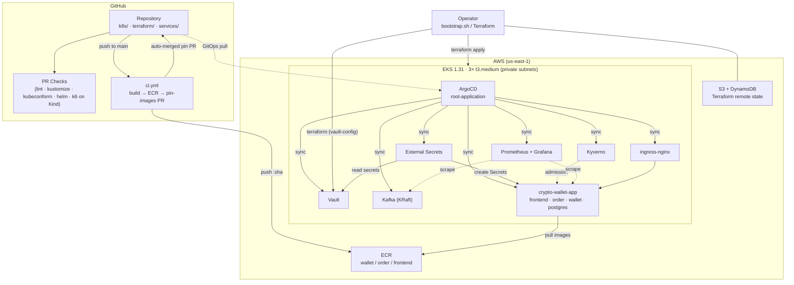
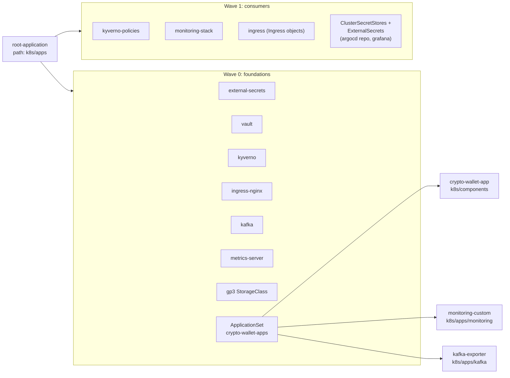
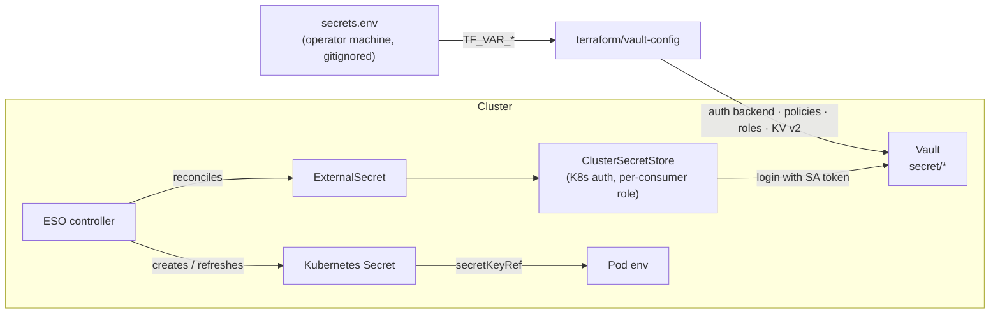
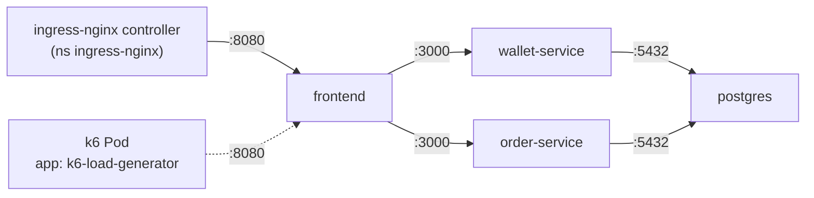
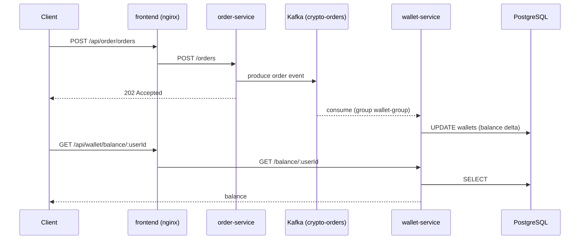
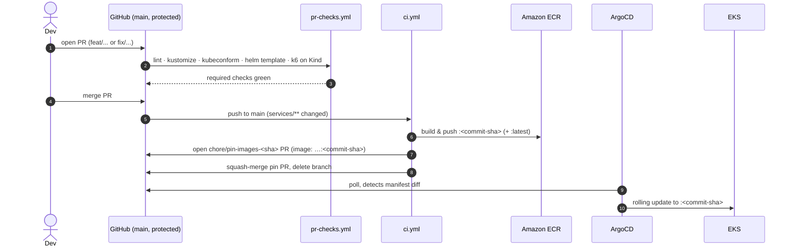

# Architecture

This document breaks down how the crypto-wallet internal developer platform
is put together. It follows a change from git to running pods, a secret
from Vault into a container, and a request through to a Grafana panel. For
setup instructions, see [README.md](README.md).

## Contents

- [1. Design principles](#1-design-principles)
- [2. System overview](#2-system-overview)
- [3. Infrastructure layer: AWS EKS via Terraform](#3-infrastructure-layer-aws-eks-via-terraform)
- [4. Delivery layer: ArgoCD GitOps](#4-delivery-layer-argocd-gitops)
- [5. Secrets layer: Vault + External Secrets Operator](#5-secrets-layer-vault--external-secrets-operator)
- [6. Policy layer: Kyverno and NetworkPolicies](#6-policy-layer-kyverno-and-networkpolicies)
- [7. Observability layer: Prometheus + Grafana](#7-observability-layer-prometheus--grafana)
- [8. Application layer: event-driven wallet](#8-application-layer-event-driven-wallet)
- [9. CI/CD pipeline and automated image pinning](#9-cicd-pipeline-and-automated-image-pinning)
- [10. Production-hardening roadmap](#production-hardening-roadmap)

## 1. Design principles

| Principle | How it's enforced |
|---|---|
| **Git is the only source of truth** | ArgoCD runs with `automated: { prune: true, selfHeal: true }` on every Application. Any change made with `kubectl edit` gets reverted. |
| **No secrets in git** | Vault holds secret values. ESO materializes them as Kubernetes Secrets at runtime. Only `.example` templates are tracked. |
| **Guardrails at admission, not in review** | Kyverno rejects non-compliant Pods (Enforce mode). The PR gate validates every manifest against real CRD schemas. |
| **Least privilege on the network** | The app namespace is default-deny for ingress. Each NetworkPolicy opens one hop of the real request path, and the VPC CNI enforces it. |
| **Immutable, traceable releases** | Images are pinned to commit SHAs by CI. A rollback is a `git revert`. |
| **Everything as code** | Terraform (infra + Vault config), Kustomize/Helm values (workloads), JSON (Grafana dashboards), k6 scripts (performance SLOs). |

## 2. System overview

## 3. Infrastructure layer: AWS EKS via Terraform

Terraform is split into three root modules. Each has its own state and
lifecycle.

| Root module | Provisions | State |
|---|---|---|
| `terraform/state-backend` | S3 bucket (versioned, SSE-encrypted, public access blocked) and DynamoDB lock table | Local (bootstrap chicken-and-egg) |
| `terraform/infra` | VPC (public and private subnets, NAT), **EKS 1.31** with a managed node group (`t3.medium`, min 1, desired 3, max 3) in private subnets, ECR repos (scan on push), **EBS CSI driver** as an EKS add-on with an IRSA role, **VPC CNI** as a managed EKS add-on with `enableNetworkPolicy: "true"` | S3 remote backend |
| `terraform/vault-config` | Vault Kubernetes auth backend, KV v2 mount, and one **policy + role + secret** per consumer through `terraform/modules/vault-config` | S3 remote backend |

The `gp3` StorageClass (`k8s/apps/ebs-storageclass.yaml`) is backed by the
EBS CSI driver. Postgres and Kafka use it for persistent volumes.

**Capacity constraint:** the VPC-CNI assigns one VPC IP per Pod and runs
without prefix delegation. That caps each `t3.medium` at **17 pods**.
Under a full HPA scale-out this limit is reached before CPU or memory, and
it is a known part of the environment's design.

## 4. Delivery layer: ArgoCD GitOps

`bootstrap.sh` installs ArgoCD and applies exactly one manifest by hand:
`k8s/root-app.yaml`. Everything else is reconciled from git.

The wave ordering prevents several bootstrap problems:

- **CRDs before custom resources.** Kyverno's `ClusterPolicy` CRD and
  ESO's `ClusterSecretStore`/`ExternalSecret` CRDs come from wave-0 charts.
  Their instances sit in wave 1 or later, and `SkipDryRunOnMissingResource`
  lets the first sync proceed before the CRDs are registered.
- **Secrets before consumers.** The Grafana admin `ExternalSecret` must
  exist before `monitoring-stack` starts Grafana.
- **Controllers before routes.** Ingress objects only resolve once the
  ingress-nginx controller is running.

**ApplicationSet.** `crypto-wallet-appset.yaml` uses a list generator to
stamp out one Application per Kustomize path. It sets `ignoreDifferences`
on `spec.replicas` for the three HPA-managed Deployments, so `selfHeal`
does not fight the autoscaler.

**Self-managed repo credential.** ArgoCD needs a credential to read the
repository before Vault exists. `bootstrap.sh` seeds that credential once,
by hand. After that, `k8s/apps/argocd-repo-secret.yaml` has ESO take over
the same Secret from Vault, so the credential is managed in git like
everything else.

## 5. Secrets layer: Vault + External Secrets Operator

There is one Vault role and one `ClusterSecretStore` per consumer, and each
role's policy grants read access only to that consumer's path:

| ClusterSecretStore | Vault role | Vault path | Target Secret |
|---|---|---|---|
| `vault-crypto-app` | `crypto-app-role` | `secret/crypto-db` | `crypto-db-secret` (crypto-wallet-app): Postgres credentials for `postgres-db` and `wallet-service` |
| `vault-monitoring` | `monitoring-role` | `secret/monitoring/grafana` | `grafana-admin-credentials` (monitoring) |
| `vault-argocd-repo` | `argocd-repo-role` | `secret/argocd-repo-creds` | `private-repo-creds` (argocd): ArgoCD's repository Secret |

Every value enters Vault from the operator's gitignored `secrets.env`
through `make vault-init`. No secret value appears in any tracked file. The
Vault Agent injector is disabled, so ESO is the only delivery path and no
mutating webhook needs managing.

## 6. Policy layer: Kyverno and NetworkPolicies

### Admission: Kyverno

`k8s/apps/kyverno-policies/disallow-missing-limits.yaml` defines the
`require-resource-limits` ClusterPolicy:

- **Mode:** `validationFailureAction: Enforce`. Non-compliant Pods are
  rejected at admission, not just reported.
- **Rule:** every container must set `resources.limits.cpu` and
  `resources.limits.memory`.
- **Scope:** all namespaces except `kube-system`, `argocd`, `kyverno` and
  `monitoring`, whose upstream charts the project doesn't control.

On a cluster with a hard pod ceiling, one unbounded container could starve
its neighbours, so this policy is what makes the HPA capacity planning
valid. The policies live in their own Application at wave 1 so they apply
only after Kyverno's CRDs exist, and the policy is checked against
Kyverno's CRD schema on every PR.

### Network: default-deny ingress

`k8s/components/network-policies.yaml` makes `crypto-wallet-app`
default-deny for ingress, then opens only the hops the request path uses:

| Policy | Selects | Allows from |
|---|---|---|
| `default-deny-ingress` | every Pod | nothing |
| `allow-ingress-nginx-to-frontend` | `app: frontend` | ingress-nginx controller Pods in the `ingress-nginx` namespace, plus the in-cluster k6 Pod (`app: k6-load-generator`), on 8080 |
| `allow-frontend-to-backends` | wallet-service, order-service | `app: frontend` on 3000 |
| `allow-backends-to-postgres` | `app: postgres` | wallet-service and order-service on 5432 |

- **Enforcement.** NetworkPolicies are only stored, not enforced, unless
  the CNI implements them. `terraform/infra/eks.tf` brings the VPC CNI
  under EKS add-on management with `enableNetworkPolicy: "true"`, which
  runs the network policy agent on every node. The CI overlay
  (`k8s/overlays/ci`) deploys the same four policies to Kind for the k6
  job.
- **Ingress only.** Egress stays open, so the services can reach Kafka in
  its own namespace and CoreDNS without extra rules. Restricting egress is
  on the [roadmap](#production-hardening-roadmap).
- **Kubelet probes** come from the node rather than a Pod, and the CNI
  allows them, so no probe rule is needed.
- **New workloads** in `crypto-wallet-app` receive no traffic until a
  matching allow rule is added to this file.

## 7. Observability layer: Prometheus + Grafana

`monitoring-stack` (kube-prometheus-stack 65.x) and `monitoring-custom`
(dashboards stored as code) provide observability. Prometheus collects
metrics from these sources:

| Source | What it provides | How it's collected |
|---|---|---|
| kube-state-metrics, node-exporter, kubelet/cAdvisor | Pod, Deployment, HPA, node CPU/memory, restarts, OOMKills | Chart defaults |
| **kafka-exporter** (`k8s/apps/kafka/`) | Topic offsets and consumer-group lag for `wallet-group` | `ServiceMonitor` |
| **k6** load tests | Request rate, latency (p95, p99, avg, max), error rate and checks, labelled by `testid` | Prometheus **remote-write receiver** (`enableRemoteWriteReceiver: true`). The in-cluster k6 Pod pushes directly to it |

**Dashboards** are plain JSON in `k8s/apps/monitoring/dashboards/`. A
`configMapGenerator` labelled `grafana_dashboard: "1"` turns them into
ConfigMaps, and the Grafana sidecar loads them automatically:

- **Crypto Wallet - Performance & Load**: k6 throughput, latency
  percentiles and errors, shown next to HPA replica counts, pod resource
  use and Kafka consumer lag. One screen explains how the system behaved
  under a given test run.
- **EKS Core & Cluster Health**: node and pod health across the cluster.

Grafana's admin credentials come from Vault through ESO. Changes to the
dashboards are made in git; edits in the UI are not persisted.

## 8. Application layer: event-driven wallet

The order path returns `202` as soon as the event is produced, so write
latency stays independent of the database. Kafka absorbs bursts, and
`kafka-pipeline-stress.js` measures how far balances lag behind orders
under sustained load. All three services scale with an HPA (70% CPU,
1 to 3 replicas). The frontend proxies the APIs on the same origin, so the
browser never handles CORS.

## 9. CI/CD pipeline and automated image pinning

**Why the pinning job exists.** ArgoCD reconciles manifests, not
registries. If CI only pushed `:latest`, the Deployment's `image:` field
would never change, and ArgoCD would never roll anything out. The
`update-manifests` job rewrites the image references in
`k8s/components/{wallet-service,order-service,frontend}.yaml` to the
immutable commit-SHA tag. That gives:

- a deployment trigger that is fully git-driven, with no
  `kubectl rollout restart`;
- a one-to-one mapping from each running image to its source commit;
- rollback by `git revert` of the pin commit.

**Why it lands as a PR.** The `main` ruleset requires a PR for every
change and has no bypass actors, and that includes CI. The job therefore
pushes a `chore/pin-images-<sha>` branch, opens a PR with `GITHUB_TOKEN`,
squash-merges it with retries while GitHub computes mergeability, and
deletes the branch. GitHub does not trigger new workflow runs from merges
made with `GITHUB_TOKEN`, so the pin cannot loop. A concurrency group
serializes runs so two quick pushes cannot race each other's pin.

**What the PR gate proves.** The `k6-performance-sanity` job builds the
PR's own images on a Kind cluster, deploys them through
`k8s/overlays/ci` behind ingress-nginx and Kafka, and enforces
`p95 < 200ms` and `< 1%` errors. Performance regressions are caught before
merge, not after deployment.

## 10. Production-hardening roadmap

Some settings in this environment were chosen deliberately for cost or
simplicity. Each would change for a production deployment:

| Area | Current (portfolio) | Production target |
|---|---|---|
| Vault | Dev mode: in-memory, auto-unsealed, root token. `make vault-init` re-seeds it after a restart | HA Raft storage, AWS KMS auto-unseal, no root-token use, short-lived auth |
| Vault roles | `crypto-app-role` and `monitoring-role` bind any ServiceAccount (`*`) in their namespaces | Bind each role to the specific ServiceAccount used by its `ClusterSecretStore` |
| Ingress | `ClusterIP` + `kubectl port-forward` | `LoadBalancer` (NLB) or AWS Load Balancer Controller, TLS via cert-manager, real DNS |
| Kafka | Single KRaft node, PLAINTEXT | 3+ brokers, RF 3, TLS + SASL, or Amazon MSK |
| PostgreSQL | Single in-cluster Pod on EBS | Amazon RDS (Multi-AZ) with automated backups |
| CI → AWS auth | Long-lived IAM access keys in GitHub secrets | GitHub OIDC → IAM role (no static credentials) |
| Image supply chain | ECR scan on push | Tag immutability, image signing (cosign), Kyverno `verifyImages` |
| Policy coverage | Resource limits | Plus: disallow privileged/root, require probes, restrict registries |
| Network policies | Default-deny **ingress** in `crypto-wallet-app` only; egress open | Default-deny egress with explicit DNS/Kafka/Postgres rules; extend default-deny to platform namespaces |
| Node networking | VPC-CNI without prefix delegation (17 pods/node) | Enable prefix delegation, or use larger/more nodes + Cluster Autoscaler/Karpenter |
